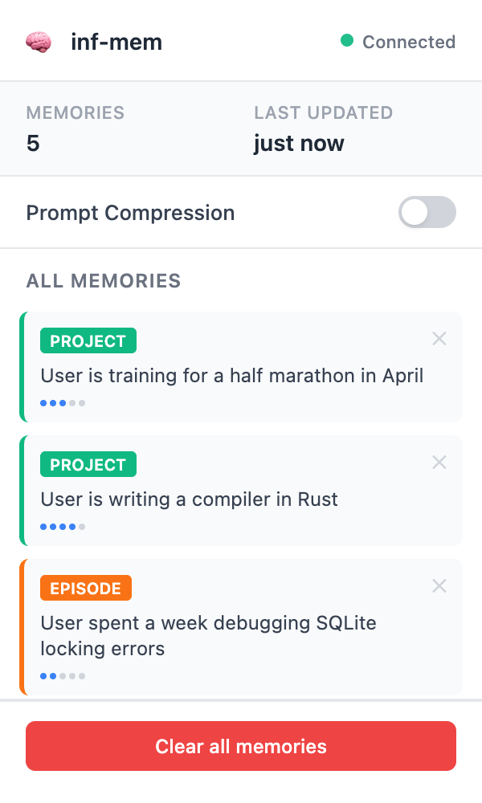

# inf-mem

[](https://github.com/Olivesz/inf-mem/actions/workflows/ci.yml)

Long-term memory for ChatGPT and Claude. A Chrome extension catches each prompt, pulls the relevant facts from a memory store on your machine, and lets you review them before they are prepended. When the reply finishes, Groq (llama-3.1-8b-instant) extracts new facts from the exchange, and inf-mem stores them locally.

<p align="center">
  
</p>
<p align="center"><sub>The real popup against a running backend, with an invented demo user. Regenerate it with <code>python docs/make_popup_screenshot.py</code>.</sub></p>

## How it works

```
You press Enter on chatgpt.com or claude.ai
  → the extension holds the prompt and asks the local backend for memories
  → bge-small embeds the prompt; memories with cosine ≥ 0.61 pass the gate
  → a panel shows what would be added: send with memory, or skip
  → the reply streams in; once it has finished, the prompt and reply go to /extract
  → Groq returns candidate facts; each is embedded and stored, unless it
    restates a stored memory almost word for word (cosine ≥ 0.98)
```

If nothing passes the gate, the prompt goes out unchanged and no panel appears.

## Results

<!-- results:start -->
**Retrieval** on [LoCoMo](https://github.com/snap-research/locomo), real embedding model, no LLM. The gate was chosen on 760 questions from five conversations; these numbers are from the other five (776 questions, 1,331 fact-style memories), which played no part in the choice. Method and caveats: [eval/calibration.md](eval/calibration.md).

| Retrieval gate | Recall@5 | Off-topic prompts that still inject memories |
|---|---|---|
| none | 0.575 | all of them (no gate) |
| 0.35 (old, hand-picked) | 0.575 | 100% |
| **0.61 (calibrated)** | **0.571** | **4.4%** |

**Dedupe**: on 180 hand-labelled pairs, no cosine threshold that merged anything was at least 90% correct on the calibration pairs, so only near-verbatim restatements merge (cosine ≥ 0.98). On the evaluation pairs, 39% of the merges the old 0.85 gate made joined two different facts.

**Latency** through the full HTTP stack, real model and store, Groq stubbed out:

| Machine | Memories | /retrieve p50 / p95 | /extract p50 / p95 |
|---|---|---|---|
| Apple M5 | 100 | 15 / 38 ms | 27 / 58 ms |
| Apple M5 | 1,000 | 19 / 48 ms | 28 / 99 ms |
| Apple M5 | 10,000 | 45 / 84 ms | 90 / 150 ms |
<!-- results:end -->

Regenerate with `make calibrate`, `make bench` and `python eval/report.py`. CI recomputes the calibration from scratch and fails if it moves.

## What leaves your machine

| Data | Goes to | When |
|---|---|---|
| The memory block you approve, plus your prompt | the chat site | when you click "Send with memory" |
| Your prompt and the finished reply | Groq | once per reply, for extraction |
| Your prompt | Groq | only if prompt compression is switched on (off by default) |
| Memories, embeddings, the embedding model | nowhere: `~/.inf_mem/` and the fastembed cache | always |

The backend listens on 127.0.0.1 and only answers `chrome-extension://` origins. A web page you visit cannot read or delete your memories.

## Quickstart

```bash
make install                     # creates .venv and installs into it
cp config.example.yaml config.yaml   # then paste a Groq key from console.groq.com
make start
make status                      # groq_configured and groq_reachable should both be true
```

The first request downloads the embedding model (about 130 MB) to the fastembed cache.

Then open `chrome://extensions`, turn on Developer mode, click **Load unpacked**, and pick the `extension/` folder.

## Tests

| Tier | Command | What it exercises |
|---|---|---|
| Unit + API | `make test` | Every endpoint through FastAPI's TestClient, CORS, the store, the extractor; Groq is mocked at the HTTP layer |
| Real model | `make test-model` | The calibrated gates with the real embedding model on fixed probe cases |
| Eval check | `make eval-check` | Recomputes the LoCoMo calibration and compares it with `eval/results/` |
| Latency | `make bench` | `/retrieve` and `/extract` at 100, 1k and 10k memories |
| Extension E2E | `make test-e2e` | The unpacked extension in Chromium, against a real backend and a fake Groq server, on fixture pages served at chatgpt.com and claude.ai: one send per prompt, one extraction per finished reply with the right prompt, composer swaps, the popup listing, deleting and clearing memories, and no manifest warnings |

CI runs all five on every push. The ChatGPT composer selectors were checked against the live site on 2026-10-13 ([record](docs/live-checks/2026-10-13-chatgpt.json)). The Claude fixture reproduces the selectors the script relies on and has not been checked against the live site yet.

## Architecture

```
extension/                   Chrome extension (MV3)
├── content/shared.js        the engine: intercept, panel, send once, extract once per reply
├── content/chatgpt.js       selectors for chatgpt.com
├── content/claude.js        selectors for claude.ai
├── background.js            service worker; the only thing that talks to the backend
└── popup/                   memory list, delete, clear all, compression toggle

backend/                     FastAPI on 127.0.0.1:7842
├── main.py                  POST /retrieve, /extract, /compress
│                            GET /memories, DELETE /memories, DELETE /memories/{id}, GET /health
├── retriever.py             bge-small-en-v1.5 via fastembed (ONNX, no PyTorch), the retrieval gate
├── extractor.py             Groq extraction and the dedupe gate
├── memory_store.py          SQLite plus a numpy matrix
└── compressor.py            optional Groq prompt compression

~/.inf_mem/
├── memories.db              text, type, keywords, importance, timestamps
├── embeddings.npy           one 384-dim vector per memory
└── memory_ids.npy           the memory ID of each vector row

eval/                        LoCoMo calibration and recall eval (results/, calibration.md)
bench/                       latency bench and committed results
```

Memories are typed `FACT`, `PROJECT`, `PREFERENCE` or `EPISODE`, with an importance from 1 to 10 that breaks ties between equally relevant memories.

## License

MIT, see [LICENSE](LICENSE).
